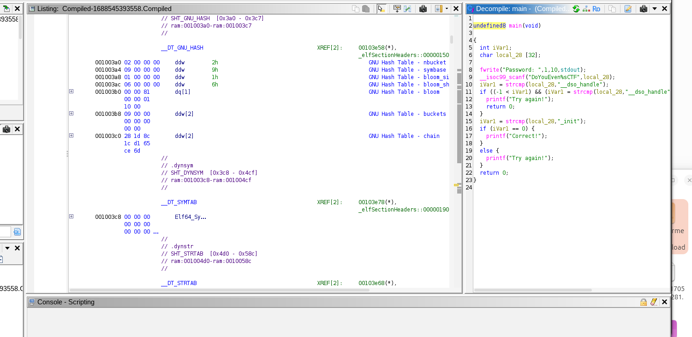

# Compiled

Source-code is writed in a programming language, normally is a text that a programmer can read and edit, a example is program.c

Compiled code its produced by a compailler, that transforms the source-code. It can contain machine code that the processor can execute directly, a example is a executable program, like program.exe

The process can be like this:
Source code → Compiler → Executable

## 1 Start

The file is compiled so its not readable, for us to see some of the words/ phrases in the file we use the comand strings filename. strings find sequences of printable characters in the file, such as letters, numvers, punctuation, and spaces.

I do strings Compiled-1688545393558.Compiled and this is what i get:
/lib64/ld-linux-x86-64.so.2
jKUhR
__cxa_finalize
__libc_start_main
strcmp
stdout
__isoc99_scanf
fwrite
printf
libc.so.6
GLIBC_2.7
GLIBC_2.2.5
GLIBC_2.34
_ITM_deregisterTMCloneTable
__gmon_start__
_ITM_registerTMCloneTable
PTE1
u+UH
StringsIH
sForNoobH
Password: 
DoYouEven%sCTF
__dso_handle
_init
Correct!
Try again!
;*3$"
GCC: (Debian 11.3.0-5) 11.3.0
Scrt1.o
__abi_tag
crtstuff.c
deregister_tm_clones
__do_global_dtors_aux
completed.0
__do_global_dtors_aux_fini_array_entry
frame_dummy
__frame_dummy_init_array_entry
zzz.c
__FRAME_END__
_DYNAMIC
__GNU_EH_FRAME_HDR
_GLOBAL_OFFSET_TABLE_
__libc_start_main@GLIBC_2.34
_ITM_deregisterTMCloneTable
stdout@GLIBC_2.2.5
_edata
_fini
printf@GLIBC_2.2.5
__data_start
strcmp@GLIBC_2.2.5
__gmon_start__
__dso_handle
_IO_stdin_used
_end
__bss_start
main
__isoc99_scanf@GLIBC_2.7
fwrite@GLIBC_2.2.5
__TMC_END__
_ITM_registerTMCloneTable
__cxa_finalize@GLIBC_2.2.5
_init
.symtab
.strtab
.shstrtab
.interp
.note.gnu.property
.note.gnu.build-id
.note.ABI-tag
.gnu.hash
.dynsym
.dynstr
.gnu.version
.gnu.version_r
.rela.dyn
.rela.plt
.init
.plt.got
.text
.fini
.rodata
.eh_frame_hdr
.eh_frame
.init_array
.fini_array
.dynamic
.got.plt
.data
.bss
.comment

This compiled program basically compares your answer with the password if its correct print correct inf they dont match he says Try aagain

The program is compiled and the sintaxe is from a c file.

I ran the program and try some of the strings but nothing, the best thing i can do now is analyse it using a decompiler, a decompiler takes compiled code and attempts to turn it into readable, higher-level code.

The decompiler im going to use is Ghidra. I never used Ghidra so i open this shit and its assembly :)

At the left the code in assembly and meta data and in the right the code writen in C.

Since im revewing some concepts, im going to remember how data was alocated in C and how assembly works.

undefined8 main(void)

## 2 Understanding the code reviewing C and Assembly
{
  int iVar1;
  char local_28 [32];
  
  fwrite("Password: ",1,10,stdout);
  __isoc99_scanf("DoYouEven%sCTF",local_28);
  iVar1 = strcmp(local_28,"__dso_handle");
  if ((-1 < iVar1) && (iVar1 = strcmp(local_28,"__dso_handle"), iVar1 < 1)) {
    printf("Try again!");
    return 0;
  }
  iVar1 = strcmp(local_28,"_init");
  if (iVar1 == 0) {
    printf("Correct!");
  }
  else {
    printf("Try again!");
  }
  return 0;
}
 this is the code that we have

 # DONE