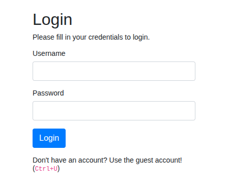
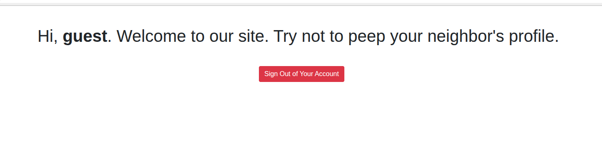
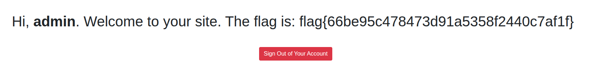

# Neighbour Lab Notes

## Login Page

We open the link and reach the login page.



The description we got is this:

Check out our new cloud service, Authentication Anywhere -- log in from anywhere you would like! Users can enter their username and password, for a totally secure login process! You definitely wouldn't be able to find any secrets that other people have in their profile, right?

Access this challenge by deploying both the vulnerable machine by pressing the green "Start Lab Machine" button located within this task, and the TryHackMe AttackBox by pressing the  "Start AttackBox" button located at the top-right of the page.

## Inspecting the Page Source

We look at the page source and find the following:

```html
<!DOCTYPE html>
<html lang="en">
<head>
    <meta charset="UTF-8">
    <title>Login</title>
    <link rel="stylesheet" href="https://stackpath.bootstrapcdn.com/bootstrap/4.5.2/css/bootstrap.min.css">
    <style>
        body{ font: 14px sans-serif; }
        .wrapper{ width: 360px; padding: 20px; margin: 0 auto; }
    </style>
</head>
<body>
    <div class="wrapper">
        <h2>Login</h2>
        <p>Please fill in your credentials to login.</p>


        <form action="/index.php" method="post">
            <div class="form-group">
                <label>Username</label>
                <input type="text" name="username" class="form-control " value="">
                <span class="invalid-feedback"></span>
            </div>
            <div class="form-group">
                <label>Password</label>
                <input type="password" name="password" class="form-control ">
                <span class="invalid-feedback"></span>
            </div>
            <div class="form-group">
                <input type="submit" class="btn btn-primary" value="Login">
            </div>
            <p>Don't have an account? Use the guest account! (<code>Ctrl+U</code>)</p>
            <!-- use guest:guest credentials until registration is fixed. "admin" user account is off limits!!!!! -->
        </form>
    </div>
</body>
</html>
```

We see that we can log in using the guest account: username: guest, password: guest.

After we log in, we see this page:



We inspect the page source and find the following:

```html
<!DOCTYPE html>
<html lang="en">
<head>
    <meta charset="UTF-8">
    <title>Welcome</title>
    <!-- admin account could be vulnerable, need to update -->
    <link rel="stylesheet" href="https://stackpath.bootstrapcdn.com/bootstrap/4.5.2/css/bootstrap.min.css">
    <style>
        body{ font: 14px sans-serif; text-align: center; }
    </style>
</head>
<body>
    <h1 class="my-5">Hi, <b>guest</b>. Welcome to our site. Try not to peep your neighbor's profile.</h1>
    <p>
        <a href="logout.php" class="btn btn-danger ml-3">Sign Out of Your Account</a>
    </p>
</body>
</html>
```

## Accessing the Admin Profile

A comment says that the admin account might be vulnerable. At first, I think we might need a brute-force attack, but I simply change the URL from `view-source:http://10.129.178.202/profile.php?user=guest` to `view-source:http://10.129.178.202/profile.php?user=admin` and gain access.



After changing the URL, we gain access to the flag.

This challenge takes about two minutes to solve.

## Vulnerability and Prevention

The vulnerability we exploit is IDOR (insecure direct object reference). The server uses a user-controlled parameter to select a profile without verifying whether the logged-in user is authorized to access it.

To prevent this, the backend needs to check both:

- **Authentication — "Who are you?"** Verify the token and identify the logged-in user.
- **Authorization — "Can you access this profile?"** Check whether that user is allowed to view the requested profile.

## Completed
