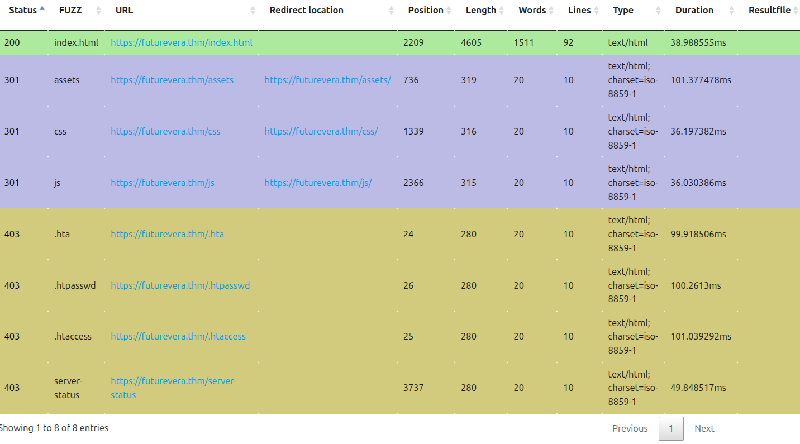

## INTRO

Hello there,

I am the CEO and one of the co-founders of futurevera.thm. In Futurevera, we believe that the future is in space. We do a lot of space research and write blogs about it. We used to help students with space questions, but we are rebuilding our support.

Recently blackhat hackers approached us saying they could takeover and are asking us for a big ransom. Please help us to find what they can takeover.

Our website is located at https://futurevera.thm

Im gona startu to look for pages that shouldnt be in the url, after if i dont discover nothing im going to look for vulnaribilities in the code, btw i already did

 nmap -sV 10.130.144.236
Starting Nmap 7.94SVN ( https://nmap.org ) at 2026-10-11 22:42 WEST
Nmap scan report for futurevera.thm (10.130.144.236)
Host is up (0.12s latency).
Not shown: 997 closed tcp ports (conn-refused)
PORT    STATE SERVICE  VERSION
22/tcp  open  ssh      OpenSSH 8.2p1 Ubuntu 4ubuntu0.13 (Ubuntu Linux; protocol 2.0)
80/tcp  open  http     Apache httpd 2.4.41 ((Ubuntu))
443/tcp open  ssl/http Apache httpd 2.4.41 ((Ubuntu))
Service Info: OS: Linux; CPE: cpe:/o:linux:linux_kernel

Service detection performed. Please report any incorrect results at https://nmap.org/submit/ .
Nmap done: 1 IP address (1 host up) scanned in 19.23 seconds
kiko@kiko-IdeaPad-Slim-3-15ARP10:~$ 

so we have ssh to explore to.

## FIRST STEP


to explore differente URLS we going to use ffuf

ffuf -u https://futurevera.thm/FUZZ -w ~/Desktop/Tools/SecLists/Discovery/Web-Content/common.txt -k

this is -u the URL that we gona test and -w the file we gona use

ffuf -u https://futurevera.thm/FUZZ -w ~/Desktop/Tools/SecLists/Discovery/Web-Content/common.txt -k -o resultados.html -of html this command saves the file in our folder, -of html defines HTML format so its easier to read

we found this 


But none of them have what we are looking for

I just realised that we tried directories, with the ffuf but the description of the challenge is challenge revolves around subdomain enumeration LOLLLLL

We going to try subdomains support.futurevera.thm, ... blog.futurevera.th... till we find some to explore

A domain is a name such as futurevera.thm. A subdomain is a name beneath that domain, such as blog.futurevera.thm, and may point to the same server or a different one.
In https://blog.futurevera.thm/posts, blog.futurevera.thm is the hostname and /posts is the path. The hostname identifies the site to contact, while the path identifies a resource within that site.
Therefore, blog.futurevera.thm and futurevera.thm/blog are different: the first uses a subdomain, while the second uses a path on the main domain. A URL path does not necessarily correspond to a physical folder on the server.

So now we going to do ffuf on the subdomain

ffuf -u https://futurevera.thm/ -H "Host: FUZZ.futurevera.thm" -w ~/Desktop/Tools/SecLists/Discovery/DNS/subdomains-top1million-5000.txt -k -ac -o subdominios.html -of html

-H "Host: FUZZ.futurevera.thm" this time we use this for subdomain

### Why the report was empty: HTTP 421

This command tests virtual hosts on the same server by changing the HTTP `Host` header. It does not look up DNS records for each subdomain.

With HTTPS, the original command uses two names:

- `-u https://futurevera.thm/` sets the TLS server name (SNI) to `futurevera.thm`.
- `-H "Host: FUZZ.futurevera.thm"` requests a name such as `blog.futurevera.thm` inside that connection.

In our manual test, the server rejected this mismatch with `421 Misdirected Request`. The default ffuf status matcher does not include 421, so these responses would not appear in the report. An empty report does not prove that no subdomains exist.

To include all HTTP response codes, including 421, add `-mc all`. Remove `-ac` as well so automatic calibration does not filter these responses:

```bash
ffuf -u https://futurevera.thm/ -H "Host: FUZZ.futurevera.thm" -w ~/Desktop/Tools/SecLists/Discovery/DNS/subdomains-top1million-5000.txt -k -mc all -o subdominios.html -of html
```

- `-mc all` includes every HTTP status code in the results; connection errors are not HTTP responses.
- Removing `-ac` disables automatic calibration and may produce many repeated results.
- A **421 response alone does not confirm that a subdomain exists**. This command makes the rejected requests visible; it does not fix the HTTPS name mismatch.
- The command runs a new scan and writes `subdominios.html` in the current directory, replacing the previous report if it has the same name.

### Next step after HTTP 421: request the blog directly with curl

After the 421 error, we used `curl` to request the blog directly over **HTTPS**:

```bash
curl -vk --connect-timeout 10 --max-time 20 --resolve blog.futurevera.thm:443:10.128.134.95 https://blog.futurevera.thm/
```

We changed two things:

- In the URL, we used `https://blog.futurevera.thm/` so the connection requested the blog from the start.
- With `--resolve`, we told curl to connect to `10.128.134.95` for `blog.futurevera.thm` on port 443, without editing `/etc/hosts`.

Both the HTTPS server name (SNI) and the HTTP Host header now used `blog.futurevera.thm`. The names matched, so the server accepted the request and returned the blog page.

This returned **200 OK**, a certificate with `CN=blog.futurevera.thm`, and a page titled **FutureVera - Blogs**. The blog site was confirmed, but no takeover vulnerability has been identified yet.

The IP `10.128.134.95` was used in this successful test. Check the current lab IP before repeating it, because restarting the machine may change its IP.

### My conclusion: how the subdomain reaches the server

In this lab, mapping `futurevera.thm` to an IP in `/etc/hosts` does not automatically map `blog.futurevera.thm` or any other subdomain. Each hostname needs its own IP mapping unless DNS already resolves it.

We supplied the blog's IP directly with `curl --resolve`. This works like a temporary hosts-file entry for that command only; the browser does not receive that mapping. To open the blog in the browser, we can add its name to the existing lab entry in `/etc/hosts`, using the current machine IP:

```text
10.128.134.95 futurevera.thm blog.futurevera.thm
```

We guessed the name `blog` from the challenge description and confirmed it when the server returned the blog page. Adding a name to `/etc/hosts` does not create a website or prove it exists; it only tells our computer where to send requests for that name.

On the Internet, DNS normally provides these mappings automatically. Subdomains can use different IP addresses, but in this test the main site and the blog responded on the same IP.

Next, inspect the blog's `about.html` and `post.html` pages and test `support.futurevera.thm` using the same matching-name approach.

